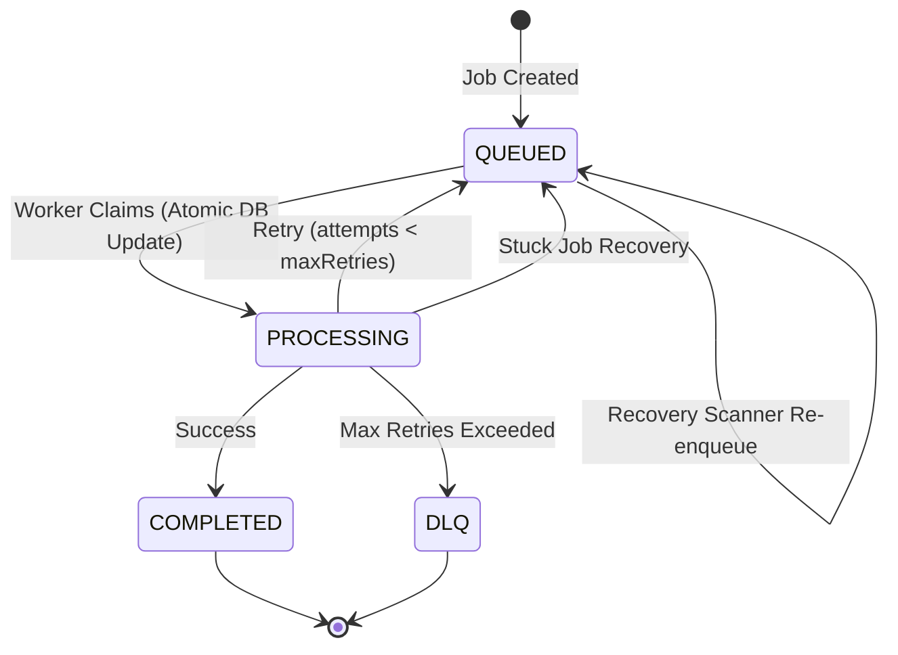
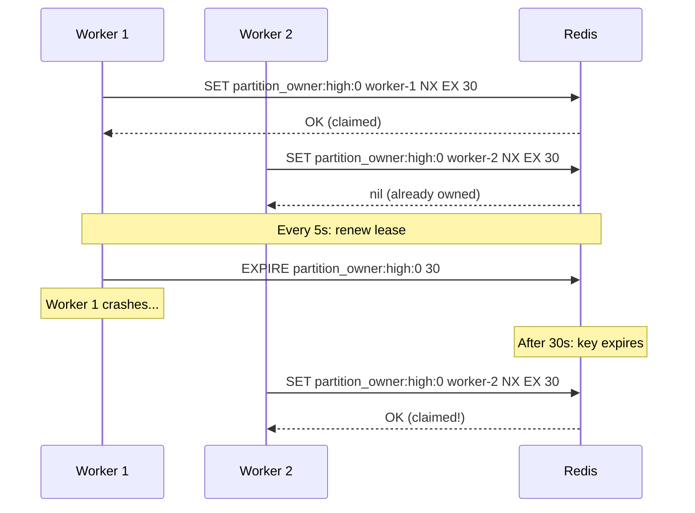

<p align="center">
  
  
  
  
  
  
  
</p>

# ⚡ Distributed Job Queue System

A **production-grade, horizontally scalable** distributed job queue built from scratch — no BullMQ, no Celery, no SQS. Every component — the scheduler, the distributed lock manager, the partition rebalancer, the rate limiter, the recovery scanner — is **hand-engineered** to demonstrate deep systems-design understanding.

> **Why this project?** Most job queues are a `npm install bullmq` away. This one exists to prove I can *design* one: handle race conditions, prevent data loss, guarantee exactly-once semantics, and scale workers horizontally — all with clear, documented reasoning in every code comment.

---

## 📑 Table of Contents

- [Architecture Overview](#-architecture-overview)
- [System Design Deep Dive](#-system-design-deep-dive)
- [Key Features](#-key-features)
- [Tech Stack](#-tech-stack)
- [Project Structure](#-project-structure)
- [Database Schema](#-database-schema)
- [API Reference](#-api-reference)
- [How It Works — Job Lifecycle](#-how-it-works--job-lifecycle)
- [Distributed Worker Coordination](#-distributed-worker-coordination)
- [Fault Tolerance & Recovery](#-fault-tolerance--recovery)
- [Observability Stack](#-observability-stack)
- [Benchmark Suite](#-benchmark-suite)
- [Getting Started](#-getting-started)
- [Configuration](#-configuration)

---

## 🏗 Architecture Overview

```
┌─────────────────────────────────────────────────────────────────────────────┐
│                            CLIENT / BENCHMARK                              │
│                          POST /jobs  ·  POST /jobs/batch                   │
└──────────────────────────────────┬──────────────────────────────────────────┘
                                   │
                    ┌──────────────▼──────────────┐
                    │        API SERVICE          │
                    │  ┌──────────┐ ┌───────────┐ │
                    │  │Rate Limit│ │  Back      │ │
                    │  │(Token    │ │  Pressure  │ │
                    │  │ Bucket)  │ │  Guard     │ │
                    │  └────┬─────┘ └─────┬─────┘ │
                    │       └──────┬──────┘       │
                    │              ▼              │
                    │     Job Controller          │
                    │     (Single + Batch)         │
                    └──────┬───────────┬──────────┘
                           │           │
              ┌────────────▼──┐  ┌─────▼────────────┐
              │  PostgreSQL   │  │   Redis            │
              │  (Source of   │  │   (Execution       │
              │   Truth)      │  │    Layer)          │
              │               │  │                    │
              │  ┌──────────┐ │  │  12 Partitioned    │
              │  │ Job Table│ │  │  Priority Queues   │
              │  │ + Indexes│ │  │  high:0-3          │
              │  └──────────┘ │  │  medium:0-3        │
              └───────────────┘  │  low:0-3           │
                                 └──────┬─────────────┘
                                        │
                     ┌──────────────────▼──────────────────┐
                     │       WORKER SERVICE (N instances)   │
                     │                                      │
                     │  ┌─────────┐  ┌──────────────────┐  │
                     │  │Partition│  │Weighted Scheduler │  │
                     │  │Ownership│  │  HIGH  = 5x      │  │
                     │  │+ Leases │  │  MEDIUM = 2x     │  │
                     │  └────┬────┘  │  LOW   = 1x      │  │
                     │       │       └──────────────────┘  │
                     │       ▼                              │
                     │  ┌──────────────────────────────┐   │
                     │  │  7-Step Job Processing        │   │
                     │  │  1. Atomic DB Claim           │   │
                     │  │  2. Redis Distributed Lock    │   │
                     │  │  3. Idempotency Check         │   │
                     │  │  4. Execute Business Logic    │   │
                     │  │  5. Mark Completed (DB)       │   │
                     │  │  6. Mark Processed (Redis)    │   │
                     │  │  7. Release Lock              │   │
                     │  └──────────────────────────────┘   │
                     └──────────────────────────────────────┘
                                        │
              ┌─────────────────────────┼────────────────────────┐
              ▼                         ▼                        ▼
   ┌──────────────────┐   ┌──────────────────┐   ┌──────────────────────┐
   │ RECOVERY SCANNER │   │  ALERT SERVICE   │   │  PROMETHEUS METRICS  │
   │                  │   │                  │   │                      │
   │ • Stuck jobs     │   │ • Failure spike  │   │ • Queue depth        │
   │ • Missed enqueue │   │   detection      │   │ • Job duration       │
   │ • Auto-requeue   │   │ • Auto-resolve   │   │ • DB latency         │
   │ • Worker health  │   │ • Rate-based     │   │ • Active workers     │
   └──────────────────┘   └──────────────────┘   └──────────────────────┘
```

---

## 🔬 System Design Deep Dive

### Dual-Write Architecture (PostgreSQL + Redis)

The system uses a **dual-write pattern** where the database is the **source of truth** and Redis is the **execution layer**:

```
Client Request
     │
     ▼
┌─────────────────┐    ┌─────────────────┐
│  1. Write to DB  │───▶│  2. Push to     │
│  (Durable)       │    │  Redis Queue    │
│                  │    │  (Fast)         │
└─────────────────┘    └─────────────────┘
```

> **Why not just Redis?** Redis is volatile — a crash loses jobs. PostgreSQL guarantees durability.  
> **Why not just PostgreSQL?** Polling a DB for work is slow. Redis `BLPOP` gives instant, blocking dequeue.  
> **What if Redis push fails after DB write?** The Recovery Scanner catches exactly this — it scans for `QUEUED` jobs that never reached Redis and re-enqueues them.

### Consistent Hashing for Queue Partitioning

Jobs are distributed across **4 partitions per priority level** (12 total queues) using a consistent hash of the `userId`:

```
hash("user-abc") % 4 = 2  →  high_priority_queue:2
```

This ensures:
- **Same user's jobs land in the same partition** → preserves ordering per user
- **Load is evenly distributed** across partitions
- **Workers can own specific partitions** → reduces contention

---

## 🎯 Key Features

### 🔧 Core Queue Engine
| Feature | Implementation |
|---|---|
| **Priority Queues** | 3-tier (HIGH / MEDIUM / LOW) with weighted scheduling (5:2:1) |
| **Partitioned Queues** | 4 partitions per priority = 12 total Redis lists, hash-routed by userId |
| **Batch Ingestion** | Bulk `createMany` in PostgreSQL + parallel Redis pushes |
| **Exactly-Once Processing** | Atomic DB claim → Redis lock → Idempotency key (3-layer guarantee) |

### 🔄 Distributed Worker Coordination
| Feature | Implementation |
|---|---|
| **Horizontal Scaling** | Spin up N workers — partitions auto-rebalance via lease-based ownership |
| **Partition Leasing** | Redis `SET NX EX` with 30s TTL — workers claim & renew leases |
| **Fair Rebalance** | Workers calculate `ceil(partitions / workers)` and shed excess partitions |
| **Worker Registry** | Heartbeat-based registration (15s TTL) — dead workers auto-expire |
| **Graceful Shutdown** | `SIGINT`/`SIGTERM` handlers release partitions before exit |

### 🛡 Fault Tolerance
| Feature | Implementation |
|---|---|
| **Automatic Retries** | Configurable `maxRetries` with jittered backoff (2–3s randomized delay) |
| **Dead Letter Queue (DLQ)** | Jobs exceeding max retries move to `DLQ` status — never silently lost |
| **Stuck Job Recovery** | Recovery Scanner detects `PROCESSING` jobs with no heartbeat → re-queues |
| **Missed Enqueue Recovery** | Detects `QUEUED` jobs >10s old never pushed to Redis → re-enqueues |
| **Lock Safety** | Distributed Redis lock with 120s TTL prevents parallel execution |
| **DB State Revert** | If lock acquisition fails after DB claim, status reverts to `QUEUED` |

### 🚦 Traffic Control
| Feature | Implementation |
|---|---|
| **Rate Limiting** | Per-user Token Bucket via **Lua script** (atomic, no race conditions) — 100 tokens, 10/sec refill |
| **Back Pressure** | Queue depth monitoring: soft slowdown >5,000 jobs, hard reject >8,000 with `Retry-After` header |

### 📊 Observability
| Feature | Implementation |
|---|---|
| **Prometheus Integration** | Custom gauges + histograms exported on `/metrics` endpoint |
| **Real-Time Metrics** | Queue depth, active workers, processing count — all from Redis |
| **Performance Histograms** | Job duration, DB latency, business logic time — per-operation breakdown |
| **Failure Spike Alerting** | Sliding-window (3-min) failure rate detection with auto-resolve |
| **JSON Metrics API** | Cached (3s TTL) metrics endpoint for dashboards |

### 🏋️ Benchmark Suite
| Feature | Implementation |
|---|---|
| **Load Generator** | Configurable job count, batch size, priority distribution |
| **Fisher-Yates Shuffle** | Randomized priority distribution for realistic load patterns |
| **Detailed Reporting** | End-to-end throughput, queue-drain throughput, success/failure rates |
| **Largest Remainder Method** | Mathematically precise priority allocation (no rounding errors) |

---

## 🛠 Tech Stack

| Layer | Technology | Purpose |
|---|---|---|
| **Runtime** | Node.js + TypeScript 5.9 | Type-safe backend |
| **Framework** | Express 5.2 | HTTP API layer |
| **Database** | PostgreSQL + Prisma 7.5 | Durable job storage (source of truth) |
| **Queue / Cache** | Redis 5.11 | Job queues, locks, metrics, rate limiting |
| **Monitoring** | Prometheus + prom-client | Time-series metrics & alerting |
| **DB Adapter** | @prisma/adapter-pg | Connection pooling via `pg` driver |

---

## 📁 Project Structure

```
Backend/
├── api-service/                    # REST API Layer
│   ├── server.ts                   # Express app, middleware chain, graceful shutdown
│   ├── dbclient.ts                 # Prisma client with pg adapter + connection pooling
│   ├── controllers/
│   │   ├── job.Controller.ts       # Single & batch job creation (DB + Redis dual-write)
│   │   └── metrics.Controller.ts   # Cached JSON metrics + Prometheus scrape endpoint
│   ├── middleware/
│   │   ├── rateLimitMiddleware.ts   # Per-user Token Bucket (Redis Lua script)
│   │   └── backPressure.middleware.ts # Adaptive queue-depth throttling
│   ├── queue/
│   │   └── jobQueue.ts             # Redis RPUSH abstraction
│   └── routes/
│       ├── job.routes.ts           # POST /jobs, POST /jobs/batch
│       └── metrics.routes.ts       # GET /metrics, GET /metrics/json
│
├── worker-service/                 # Distributed Workers
│   ├── workers/
│   │   └── worker.ts              # 600-line orchestrator: partition claiming,
│   │                              #   heartbeat, rebalance, 7-step processing
│   ├── processors/
│   │   └── jobProcessor.ts        # Business logic dispatcher (EMAIL, IMAGE, etc.)
│   └── scheduler/
│       └── schedular.ts           # Weighted round-robin with adaptive backoff
│
├── alert-service/
│   └── alert.ts                   # Sliding-window failure spike detector
│
├── recovery-service/
│   └── scanner.ts                 # Stuck & missed job recovery daemon
│
├── shared/                        # Shared infrastructure
│   ├── cluster/
│   │   └── workerRegistry.ts      # Worker heartbeat registration (Redis TTL)
│   ├── metrics/
│   │   ├── metrics.ts             # Redis-backed metric counters (per-type + totals)
│   │   ├── prometheus.ts          # Prometheus gauges, histograms, queue depth
│   │   └── metricsServer.ts       # Standalone metrics HTTP server for workers
│   ├── redis/
│   │   ├── redisClient.ts         # Redis connection with event handlers
│   │   └── tokenBucket.ts         # Atomic Lua rate-limiter script
│   └── utils/
│       ├── partition.ts           # Consistent hash → queue partition mapper
│       └── partitionOwnership.ts  # Redis-based lease claim / renew / release
│
├── benchmark/                     # Performance testing
│   ├── index.ts                   # Entry point
│   ├── benchmarkRunner.ts         # Orchestrator: submit → wait → report
│   ├── loadGenerator.ts           # Batch submission with priority distribution
│   ├── benchMarkReport.ts         # Throughput & success rate calculator
│   ├── config.ts                  # Tunable parameters
│   └── types.ts                   # TypeScript interfaces
│
├── prometheus/
│   └── prometheus.yml             # Scrape config (API + Worker targets)
│
└── prisma/
    └── schema.prisma              # Database schema with 7 composite indexes
```

---

## 🗄 Database Schema

```prisma
model Job {
  id           String      @id @default(uuid())
  payload      Json                              // Flexible JSON payload
  priority     JobPriority @default(MEDIUM)       // HIGH | MEDIUM | LOW
  status       JobStatus   @default(QUEUED)       // QUEUED → PROCESSING → COMPLETED | DLQ
  attempts     Int         @default(0)            // Current retry count
  maxRetries   Int         @default(3)            // Configurable retry limit
  startedAt    DateTime?                          // Processing start timestamp
  completedAt  DateTime?                          // Completion timestamp
  workerId     String?                            // Which worker owns this job
  errorMessage String?                            // Last error (for debugging)
  createdAt    DateTime    @default(now())
  updatedAt    DateTime    @updatedAt
  failedAt     DateTime?                          // DLQ timestamp
  type         String                             // Job type (EMAIL, IMAGE, etc.)
  userId       String                             // Owner / tenant

  @@index([userId])                // User lookups
  @@index([userId, status])        // User + status filter
  @@index([status])                // Queue scanning
  @@index([status, createdAt])     // Recovery scanner (missed jobs)
  @@index([status, startedAt])     // Recovery scanner (stuck jobs)
  @@index([completedAt])           // Completion reports
  @@index([createdAt])             // Time-range queries
}
```

> **7 composite indexes** are specifically designed for the query patterns used by the worker, recovery scanner, and metrics system — no full table scans.

---

## 📡 API Reference

### `POST /jobs` — Create Single Job
```json
// Request
{
  "userId": "user-123",
  "type": "EMAIL",
  "priority": "high",
  "payload": { "to": "user@example.com", "subject": "Hello" },
  "maxRetries": 5
}

// Response (201)
{
  "jobId": "550e8400-e29b-41d4-a716-446655440000",
  "status": "QUEUED",
  "userId": "user-123",
  "priority": "high"
}
```

### `POST /jobs/batch` — Bulk Job Submission
```json
// Request
{
  "userId": "user-123",
  "jobs": [
    { "type": "EMAIL", "priority": "high", "payload": { "to": "a@b.com" } },
    { "type": "IMAGE", "priority": "low", "payload": { "file": "img.png" } }
  ]
}

// Response (201)
{
  "message": "Batch processing completed",
  "totalReceived": 2,
  "totalAccepted": 2,
  "totalFailed": 0,
  "jobs": [...]
}
```

### `GET /metrics` — Prometheus Scrape Endpoint
### `GET /metrics/json` — JSON Metrics (3s cache)
### `GET /health` — Redis Health Check

---

## 🔄 How It Works — Job Lifecycle



### The 7-Step Worker Processing Pipeline

```
Step 1: ATOMIC DB CLAIM
   └─ updateMany WHERE id=X AND status=QUEUED → SET status=PROCESSING
   └─ If 0 rows affected → another worker won → skip

Step 2: REDIS DISTRIBUTED LOCK
   └─ SET lock:{jobId} NX EX 120
   └─ If fails → revert DB to QUEUED (critical safety!)

Step 3: IDEMPOTENCY CHECK
   └─ EXISTS processed:{jobId} → if yes, skip (fast path)

Step 4: EXECUTE BUSINESS LOGIC
   └─ processJob(job) → EMAIL / IMAGE / custom handler

Step 5: MARK COMPLETED (DB)
   └─ UPDATE status=COMPLETED, completedAt=now()

Step 6: MARK PROCESSED (REDIS)
   └─ SET processed:{jobId} true EX 3600 (1hr TTL)

Step 7: RELEASE LOCK
   └─ DEL lock:{jobId}
```

> Each step has a specific purpose documented in inline comments — the separation between DB ownership, Redis locking, and idempotency checking is intentional defense-in-depth.

---

## 🤝 Distributed Worker Coordination

### Partition Ownership via Leases



### Auto-Rebalancing Algorithm

When workers join or leave, partitions automatically rebalance:

```
Fair Share = ceil(12 partitions / N workers)

2 workers → 6 partitions each
3 workers → 4 partitions each
4 workers → 3 partitions each

If a worker owns more than fairShare + 1:
  → Release excess partitions
  → Other workers claim them in their next claim cycle
```

### Weighted Round-Robin Scheduler

The scheduler ensures high-priority jobs get more CPU time *without starving* lower priorities:

```
Weight Ratio:  HIGH=5  MEDIUM=2  LOW=1

Schedule: [H, H, H, H, H, M, M, L]  (repeats)

Adaptive Backoff:
  • 3 consecutive empty polls → 500ms backoff on that queue
  • Job found → reset backoff immediately
```

---

## 🛡 Fault Tolerance & Recovery

### Recovery Scanner (Daemon)

Runs every **5 seconds**, handling two failure modes:

| Failure Mode | Detection | Recovery |
|---|---|---|
| **Missed Enqueue** | `QUEUED` jobs >10s old | Re-push to correct Redis partition |
| **Stuck Processing** | `PROCESSING` jobs >10s with dead worker | Reset to `QUEUED` + re-enqueue |

The scanner checks worker liveness before declaring a job stuck — if the worker's heartbeat is still alive, the job is left alone.

### Alert Service

Sliding-window failure rate detection:

```
Every 30 seconds:
  1. Sum failures across last 3 minute-buckets
  2. If failureRate > 5% AND totalProcessed > 100:
     → SET alert:failure_spike "firing" NX EX 300
     → Log 🚨 ALERT
  3. If condition clears:
     → SET alert:failure_spike "ok" EX 300
     → Log ✅ RESOLVED
```

> Uses Redis `NX` to prevent duplicate alerts and `EX` to auto-clear stale state.

---

## 📊 Observability Stack

### Prometheus Metrics

| Metric | Type | Description |
|---|---|---|
| `queue_processed_total` | Gauge | Total successfully processed jobs |
| `queue_failed_total` | Gauge | Total failed jobs |
| `queue_retry_total` | Gauge | Total retried jobs |
| `queue_dlq_total` | Gauge | Total jobs in Dead Letter Queue |
| `queue_processing_jobs` | Gauge | Currently processing job count |
| `queue_active_workers` | Gauge | Live worker count |
| `queue_depth` | Gauge (labeled) | Per-queue depth for all 12 partitions |
| `queue_job_duration_seconds` | Histogram | End-to-end job processing time |
| `queue_db_duration_seconds` | Histogram | Database operation latency |
| `queue_business_logic_duration_seconds` | Histogram | Business logic execution time |

### Prometheus Scrape Config

```yaml
scrape_interval: 5s

scrape_configs:
  - job_name: "api-service"       # localhost:3000/metrics
  - job_name: "worker-service"    # localhost:3001/metrics
```

---

## 🏋️ Benchmark Suite

The built-in benchmark suite generates realistic load and measures end-to-end throughput:

```bash
npm run benchmark
```

### Configuration

```typescript
{
  TOTAL_JOBS: 100,
  BATCH_SIZE: 10,
  PRIORITY_DISTRIBUTION: { HIGH: 50%, MEDIUM: 30%, LOW: 20% },
  PROCESSING_TIME_MS: { MIN: 0, MAX: 10 },
  BENCHMARK_TIMEOUT_MS: 600_000   // 10 min safety
}
```

### Sample Report Output

```
======================================
          Benchmark Report
======================================

--- Timing ---
Overall Duration          : 12.34 sec
Submission Duration       : 1.52 sec
Queue Drain Duration      : 10.82 sec

--- Throughput ---
End-to-End Throughput     : 8.10 jobs/sec
Queue-Drain Throughput    : 9.24 jobs/sec

--- Job Statistics ---
Configured Jobs           : 100
Submitted Jobs            : 100
Completed Jobs            : 100
Jobs in DLQ               : 0

--- Rates ---
Job Success Rate          : 100.00%
Submission Success Rate   : 100.00%
======================================
```

---

## 🚀 Getting Started

### Prerequisites

- **Node.js** ≥ 18
- **PostgreSQL** (running on port 5432)
- **Redis** (running on port 6379)

### Installation

```bash
# Clone the repository
git clone https://github.com/yourusername/Distributed_Job_Queue_System.git
cd Distributed_Job_Queue_System/Backend

# Install dependencies
npm install

# Set up environment
cp .env.example .env
# Edit .env with your PostgreSQL connection string

# Run database migrations
npx prisma migrate dev

# Generate Prisma client
npx prisma generate
```

### Running the System

```bash
# Terminal 1: Start the API server
npm run dev

# Terminal 2: Start a worker
npm run worker

# Terminal 3 (optional): Start additional workers for horizontal scaling
npm run worker

# Terminal 4 (optional): Run benchmarks
npm run benchmark
```

### Running with Prometheus

```bash
# Terminal 5: Start Prometheus
cd prometheus
./prometheus --config.file=prometheus.yml
# Dashboard available at http://localhost:9090
```

---

## ⚙ Configuration

### Environment Variables

| Variable | Default | Description |
|---|---|---|
| `DATABASE_URL` | — | PostgreSQL connection string |
| `PORT` | `3000` | API server port |
| `WORKER_METRICS_PORT` | `3001` | Worker Prometheus metrics port |
| `API_URL` | `http://localhost:3000/jobs/batch` | Benchmark target URL |

### Tunable Constants

| Constant | Value | Location | Purpose |
|---|---|---|---|
| Rate Limit Capacity | 100 tokens | `rateLimitMiddleware.ts` | Max burst per user |
| Refill Rate | 10/sec | `rateLimitMiddleware.ts` | Token regeneration |
| Backpressure Soft | 5,000 jobs | `backPressure.middleware.ts` | Add 50ms delay |
| Backpressure Hard | 8,000 jobs | `backPressure.middleware.ts` | Reject with 429 |
| Partition Lease TTL | 30s | `partitionOwnership.ts` | Ownership expiry |
| Worker Heartbeat TTL | 15s | `workerRegistry.ts` | Liveness timeout |
| Stuck Job Threshold | 10s | `scanner.ts` | Recovery trigger |
| Lock TTL | 120s | `worker.ts` | Execution safety window |
| Weighted Schedule | 5:2:1 | `schedular.ts` | Priority CPU allocation |

---

## 🧠 Design Decisions & Trade-offs

| Decision | Reasoning |
|---|---|
| **PostgreSQL as source of truth** | Durability guarantee — Redis is volatile |
| **Redis for queue operations** | `BLPOP` gives O(1) blocking dequeue; DB polling doesn't scale |
| **Lua-based rate limiter** | Atomic token bucket — no race conditions even under concurrent load |
| **Partition-based queues** | Reduces lock contention vs. single queue; enables per-user ordering |
| **Lease-based ownership** | No centralized coordinator needed; crash recovery via TTL expiry |
| **3-layer exactly-once** | DB claim → Redis lock → idempotency key — defense in depth |
| **Jittered retry delays** | `2000 + random(1000)ms` prevents thundering herd on retries |
| **Fail-open middleware** | Rate limiter and backpressure fail open — availability over strictness |
| **Recovery scanner batching** | `take: 50` limits per-scan to prevent DB overload |

---

<p align="center">
  Built with 💻 and a deep love for distributed systems.
</p>

